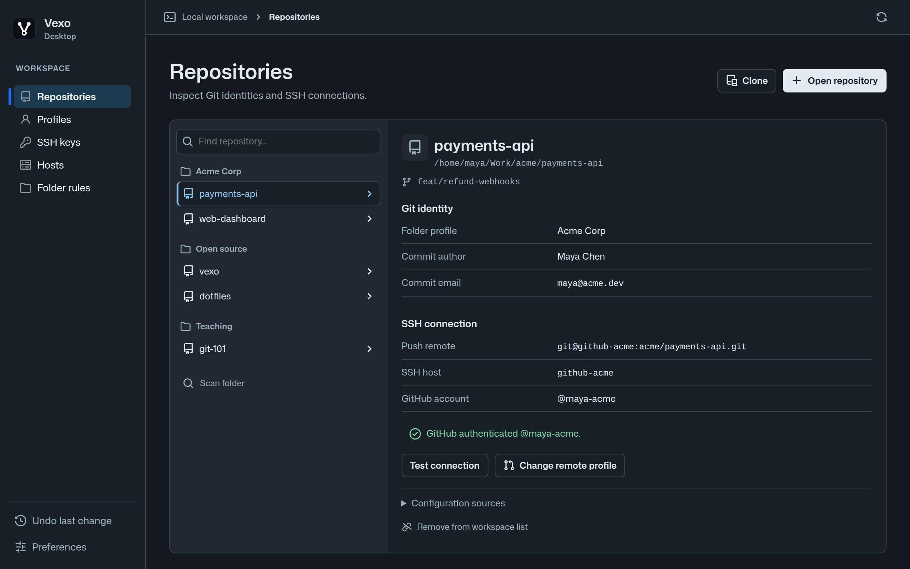

<p align="center">
  
</p>

<h1 align="center">Vexo</h1>

<p align="center">Every GitHub account. The right key. Every time.</p>

Vexo is a desktop app that manages SSH keys, GitHub accounts, commit authors and folder rules, so every repository pushes with the right identity. It previews every configuration change as a diff and can undo the last one.



## Repository layout

This is a [Turborepo](https://turborepo.dev) monorepo managed with pnpm.

| Path | What it is |
|---|---|
| `apps/desktop` | The Vexo desktop app (Tauri 2, React, Rust). See its [README](apps/desktop/README.md). |
| `apps/web` | The marketing and download website (Next.js, GitHub Primer tokens). |
| `packages/typescript-config` | Shared TypeScript settings. |
| `packages/eslint-config` | Shared ESLint settings. |

## Getting started

Install Node.js 22.12+, pnpm 10, Rust, Git, OpenSSH, and the [Tauri prerequisites](https://v2.tauri.app/start/prerequisites/).

```sh
pnpm install
pnpm desktop        # run the desktop app
pnpm dev:web        # run the website on http://localhost:3000
```

## Common tasks

```sh
pnpm build                          # build every app
pnpm turbo run check-types lint test
pnpm desktop:bundle                 # build apps/desktop/src-tauri/target/release/bundle/deb/Vexo_<version>_amd64.deb
```

## Publishing a release

The website's download buttons point to the latest GitHub release asset named `Vexo_<version>_amd64.deb`, using the version in `apps/desktop/src-tauri/tauri.conf.json`.

```sh
pnpm desktop:bundle
gh release create v0.1.1 "apps/desktop/src-tauri/target/release/bundle/deb/Vexo_0.1.1_amd64.deb" --title "Vexo 0.1.1"
```

Set these when deploying the website if they differ from the defaults:

| Variable | Purpose |
|---|---|
| `NEXT_PUBLIC_SITE_URL` | Public URL of the website, used for social previews |
| `NEXT_PUBLIC_REPO_URL` | GitHub repository URL |
| `NEXT_PUBLIC_DOWNLOAD_URL` | Override the .deb download link |
